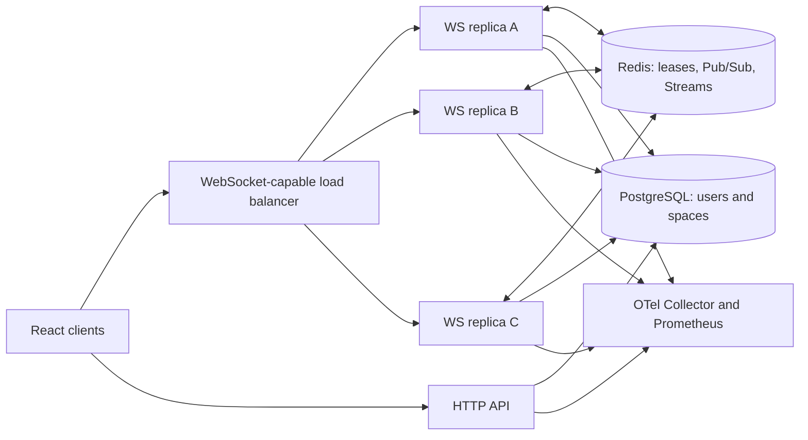

# SkyScope platform engineering roadmap

Status: proposed plan, based on source inspection on 2026-09-11. No implementation or performance results are claimed by this document.

Objective: evolve the existing virtual office into a reproducible, observable real-time service that runs across replicas, recovers from failures, and has published measurements. For the supplied Atlassian Micros Central role, the strongest evidence is safe deployment, failure recovery, operational visibility, and a developer workflow another engineer can reproduce.

Planning assumption: one developer, approximately 80-120 focused hours over 6-8 weeks. Estimates depend on familiarity with Redis and Kubernetes; use the acceptance gates below to determine completion. Start locally with Docker Compose and a local Kubernetes cluster; paid cloud infrastructure is optional.

## 1. What exists today

| Source | Finding | Consequence |
| --- | --- | --- |
| `metaverse/apps/ws/src/roomManager.ts` | Rooms and recipients are stored in a process-local map. | Users on different replicas cannot communicate through the active routing path. |
| `metaverse/apps/ws/src/services/message.ts`, `services/voice.ts` | Redis-related implementations are commented out. | Installed Redis packages do not demonstrate working distributed routing. |
| `metaverse/apps/ws/src/index.ts`, `User.ts` | Both register close handlers that call `destroy()`. Removal matches user ID rather than connection identity. | Duplicate leave notifications and an old socket removing a replacement session are possible. |
| `metaverse/apps/ws/src/User.ts` | JSON parsing and JWT verification lack a surrounding error boundary; actions have no shared runtime schema or joined-state guard. | Invalid traffic and overlapping async joins need handling before load tests. |
| `metaverse/apps/ws/src/roomManager.ts` | Private messages are serialized before calling `User.send`, which serializes again. | Fix and test the wire format before distributing it. |
| `metaverse/apps/nexus-office-env/src/pages/Office.tsx` | The active socket handler marks disconnection but does not reconnect. Saved position comes from local storage. | Server-authoritative recovery and a client connection state machine are needed. |
| `metaverse/apps/nexus-office-env/src/hooks/useWebSocket.ts` | Entire hook is commented out. | Implement recovery in the active client path; editing this file alone changes no behavior. |
| HTTP/WS package scripts and root `postbuild` | Builds/install hooks can change database state; package managers and schema locations are inconsistent. | Clean builds and deployments are not yet isolated or reproducible. |
| `render.yaml` | HTTP and WS independently request generated JWT secrets. | Configure a shared secret so authentication works consistently. |
| `Tests/index.test.js`, `Tests/package.json` | Existing tests target one localhost WS endpoint; CommonJS imports coexist with an ESM package declaration. | Repair the test harness and add tests against distinct replicas. Existing tests were inspected, not executed. |

Source also contains credential material in commented Redis examples, and HTTP/WS logging includes authentication data. Remove these values from code and logs; rotate any credentials that are still valid before publishing. Do not copy them into documentation or benchmark artifacts.

Existing frontend edits were present during inspection. Implementation must preserve them, especially when extracting the socket lifecycle from `Office.tsx`.

## 2. Target architecture and guarantees



Keep Node.js, TypeScript, `ws`, React, and PostgreSQL. Pick one Redis client and pin dependencies. A rewrite or additional business microservices is unnecessary for this milestone. A socket belongs to one replica for its lifetime; reconnects can land on any replica without sticky sessions.

| Data/event | Proposed mechanism | Contract |
| --- | --- | --- |
| Movement | Redis latest-position state plus Pub/Sub | Intermediate updates may be lost; session generation and monotonic sequence numbers reject stale updates. Recovery uses a fresh snapshot. |
| Presence | Redis session leases, room membership index, expiry sweep | Presence converges within a documented expiry bound; a stale connection cannot mutate a newer session. |
| Group/private chat | Bounded Redis Stream per space | Ordered within that stream; replay after the client's cursor, with authorization filtering for private messages. |
| WebRTC signaling | Pub/Sub, call ID, negotiation generation, short expiry | Best effort and transient; restart negotiation after reconnect rather than replaying obsolete offers/ICE. |
| Users/spaces | Existing PostgreSQL models | Retain authoritative application records in PostgreSQL. |

Redis Pub/Sub has at-most-once delivery and cannot supply reconnect history. Streams provide retained entries and cursors. Each WS replica must independently read the streams needed by its local clients; putting every replica in one shared consumer group would distribute entries between replicas instead of broadcasting them. See [Redis Pub/Sub](https://redis.io/docs/latest/develop/pubsub/) and [Redis Streams](https://redis.io/docs/latest/develop/data-types/streams/).

Define recovery boundaries explicitly: initial chat retention is 24 hours subject to a configured per-room entry cap, whichever expires first. Return `resync-required` for an expired cursor and clearly show any unavailable history. Size caps from measured traffic and Redis memory. Enable Redis persistence and document its actual loss window; stream acceptance is not a guarantee that data survives every Redis crash or failover. Initial failure guarantees cover WS replica failure while Redis remains available. Redis HA and permanent chat archival are separate extensions.

Use delivery retries plus idempotent processing. Do not claim globally exactly-once delivery. Redis idempotency does not automatically protect future PostgreSQL mutations: such operations need a database unique constraint/transaction and, when emitting events, a transactional outbox.

## 3. Ordered implementation milestones

### Phase 0 — Reproducible baseline and protocol safety (10-16 hours)

- Standardize pnpm and a supported, pinned Node runtime. Make install/build independent of database availability; run versioned migrations explicitly as a release step. Consolidate Prisma schema/client ownership.
- Repair the existing integration runner, parameterize endpoints, and add deterministic test fixtures with cleanup in an isolated test database.
- Introduce `packages/protocol` with validated inbound/outbound messages. Catch JSON/auth errors, require a completed join before actions, serialize per-connection commands, and impose message size/rate limits.
- Derive sender and space from authenticated session state, not arbitrary payload fields. Verify private recipients belong to the authorized space. Keep the existing room access model explicit; do not silently introduce a new invitations feature.
- Fix double serialization and duplicate close cleanup. Bound outbound queues using socket buffered bytes; coalesce movement updates and disconnect persistently slow consumers with a recoverable reason.
- Add a basic Compose environment for PostgreSQL, Redis, HTTP, and one WS replica. Record a baseline chat load test before replacing routing. Introduce JSON logs and the connection/error counters needed for the baseline.

Gate: a clean checkout can install, build, initialize the test database, and run join/move/chat/disconnect tests. Bad JSON, bad JWTs, commands before join, repeated join, and unauthorized private routing do not crash the service or bypass authorization. Preserve raw baseline results.

### Phase 1 — Session ownership, heartbeats, and shared presence (12-18 hours)

- Separate account `userId`, logical `sessionId`, and per-connection `connectionId`/generation. Support separate tabs as separate sessions; aggregate room presence by user.
- Give every resumed session a new server-controlled ownership generation. Redis compare-and-update/delete operations must check that generation for heartbeats, state writes, and cleanup. Resume requires authentication and a session-bound resume credential.
- Send server WebSocket ping frames every 15 seconds; refresh a 45-second Redis lease only after a valid pong from the current owner. Browser WebSocket implementations handle protocol pong responses automatically.
- Maintain an expiry index and sweep every 5 seconds in bounded batches. Atomically confirm expiry and ownership before removing membership. Multiple replicas can sweep safely. Do not depend solely on key-expiry notifications.
- Keep active-presence expiry separate from resumable session metadata, retained initially for 5 minutes. Expired presence is never reported as online merely because metadata remains.
- Read room snapshots from shared state; use versions and periodic reconciliation to repair missed presence notifications.

Gate: absent scheduling/dependency delays, a silent session disappears within 50 seconds of its last accepted pong. Kill a replica and verify that bound. Reconnect to another replica, then close the old socket: the replacement remains present. Closing one tab must not remove another active tab.

### Phase 2 — Distributed routing, replay, and idempotency (18-26 hours)

- Replace local-only broadcasts with Pub/Sub subscriptions scoped to locally active rooms. Apply broadcasts locally once, avoid publish loops, and route private chat/signaling across replicas.
- Define a versioned envelope containing `eventId`, type, payload, logical session, client sequence, and optional tracing context. Derive authenticated fields on the server. Reliable responses also carry a server stream cursor.
- Generate an event ID once on the client and reuse it for every retry. Scope deduplication by authenticated user, space, and ID; reject reuse with different content. IDs must remain stable across socket replacement.
- Atomically append accepted chat to its stream and store the deduplication result through a validated Redis script. A duplicate returns the original result/cursor. A crash between a standalone `SET NX` and append must not lose the action. Retain deduplication records for at least the accepted retry window; use server-issued resume/session expiry to reject stale retries.
- Every replica independently tails relevant room streams and delivers only to authorized local recipients. Private content must never leak through replay or snapshots. Acknowledgment means accepted into the stream, not that every recipient has read it.
- Client state machine: connecting, authenticating, synchronizing, connected, reconnecting, stopped. Use exponential backoff with full jitter, capped at 30 seconds; terminate retry on logout or unrecoverable authentication failure.
- Resume chat after the last applied cursor; deduplicate visible messages by event ID. Buffer live events while replaying through a captured high-water cursor, then release newer events in order. Bound buffers; fall back to resynchronization when exceeded.
- Replace presence/position state from a fresh versioned snapshot. Do not replay old movement commands or expired call negotiations. Retry only explicitly supported, unacknowledged reliable commands.

Gate: users deliberately connected to different replicas can communicate. Send the same event concurrently through two replicas and get one stream entry and one visible action. Kill a replica after append but before acknowledgment; retry returns the same result. Exercise replay/live overlap, stale cursors, Redis interruption, private replay authorization, and a slow receiver.

### Phase 3 — Observability and dependency failure behavior (10-14 hours)

- Initialize OpenTelemetry before instrumented libraries. Trace HTTP requests and individual WS events, with spans for validation, Redis operations, replay, and delivery. Inject/extract trace context across the Redis envelope. Avoid one hours-long connection span. See [OpenTelemetry propagation](https://opentelemetry.io/docs/languages/js/propagation/).
- Export OTLP through a Collector to one trace backend, such as Jaeger. Use Pino or equivalent JSON logs with service, replica, event type/ID, outcome, and trace/span IDs. Redact tokens, message bodies, and call payloads.
- Expose Prometheus metrics for active sockets, accepted/rejected events, duplicate suppression, handler latency, heartbeat expiry, replay volume/lag, buffered bytes, reconnects, Redis errors, and drain duration. Include process memory, CPU, and event-loop delay.
- Limit metric labels to bounded categories such as event type and outcome. Put user/session/event/room identifiers in appropriate logs or traces, not metric labels. See [Prometheus naming guidance](https://prometheus.io/docs/practices/naming/).
- Build a dashboard and alerts for sustained errors, latency, stalled replay, and dependency loss. Declare initial SLO targets as hypotheses and revise them from measured results.
- On Redis loss, stop accepting distributed joins/actions, fail readiness, and return explicit retryable errors where possible. Bound pending work; after reconnection, reconcile sessions and cursors before becoming ready. Telemetry backend failure should not block user requests.

Gate: follow a sampled event across replicas in tracing, correlate its logs, and see induced Redis failure in metrics. Run with the telemetry backend stopped and confirm bounded resource use and continued application operation where dependencies permit.

### Phase 4 — Graceful draining and Kubernetes (14-20 hours)

- Build multi-stage, non-root images with immutable version tags, direct Node signal delivery, and no schema mutation during image build/startup. Extend Compose to three replicas behind a WebSocket-capable proxy, plus optional observability services.
- On SIGTERM: mark draining, reject upgrades/new work, notify existing clients to reconnect with jitter, finish bounded in-flight accepted operations, close sockets with a restart reason, release only owned sessions, close database/Redis clients, and flush telemetry.
- Start with a 20-second drain deadline inside a 30-second Kubernetes termination grace period. Any preStop hook consumes this same budget. Test actual proxy endpoint propagation; a hook or readiness change alone does not move established sockets.
- Provide `/livez` for process responsiveness, `/readyz` for initialized/non-draining service and required dependencies/subscriptions, and a startup probe. A Redis outage must not cause a liveness restart loop. See [Kubernetes probes](https://kubernetes.io/docs/concepts/workloads/pods/probes/) and [Pod termination](https://kubernetes.io/docs/concepts/workloads/pods/pod-lifecycle/#pod-termination).
- Deploy three replicas with Service, WebSocket-capable ingress/proxy, requests/limits, ConfigMap/Secret references, rolling strategy (`maxUnavailable: 0`, `maxSurge: 1`), and PodDisruptionBudget (`minAvailable: 2`). Account for spare rollout capacity; PDBs do not prevent every disruption or govern Deployment rolling updates.
- Supply a local kind/k3d setup and Kustomize base/overlay. Run migrations once as a controlled release Job using backward-compatible schema changes. Treat single-instance local Redis/PostgreSQL as explicit infrastructure limitations.
- Add CI for types/tests, image build, and an integration smoke test. Document a deployment command, readiness wait, smoke test, and rollback. Automating public deployment is optional and requires its own destination/credentials.

Gate: under active traffic, roll a release and remove a WS pod. Clients recover through another replica; every acknowledged chat remains recoverable within retention while Redis survives. Quantify the user-visible interruption. Validate readiness rejection during drain and shutdown within the deadline; do not describe WebSocket migration as seamless without measurement.

### Phase 5 — Measurements, failure drills, and portfolio evidence (16-26 hours)

- Use k6 WebSockets with custom Trend metrics for message latency; built-in connection metrics are not chat delivery latency. See [k6 WebSockets](https://grafana.com/docs/k6/latest/using-k6/protocols/websockets/) and [custom Trends](https://grafana.com/docs/k6/latest/javascript-api/k6-metrics/trend/).
- Build scripts for baseline traffic, increasing load, reconnect bursts, duplicate injection, slow consumers, and traffic during rollout/replica failure. Seed synthetic users/spaces through a repeatable fixture process.
- Compare one and three replicas with identical per-replica limits, documenting the increase in total resources. Optionally add an equal-total-resource comparison to isolate horizontal scaling effects.
- Include a 60-minute soak and preserve raw outputs and failed runs. Change only one meaningful tuning variable per comparison.
- Publish `benchmarks/RESULTS.md`, raw summaries, exact commands/configuration, architecture decisions, runbooks, and a short recorded demonstration. Replace README claims that exceed tested behavior.

Gate: another engineer can repeat the reported workload, locate the raw measurements, and explain how latency, failure rate, memory, and recovery change with load. Record an observed bottleneck and one measured improvement.

## 4. Benchmark contract

Initial test ladder: 100, 500, 1,000, and optionally 2,000 simultaneous joined sockets, stopping at resource limits. These are workload targets, not achieved results. First trial target: 1,000 joined sockets with chat round-trip p95 below 200 ms and logical chat failure rate below 0.1% in a declared local environment. Adjust after the baseline; retain and report failures to meet the target.

Main workload: 20 users per room, 2 movement updates/second/user, 1 chat message/10 seconds/user, approximately 256-byte chat payload. Also run a separate hot-room scenario to expose broadcast amplification. Report generated events/second and delivered recipient messages/second; they are different quantities. WebRTC media is peer-to-peer and excluded from WS server capacity claims.

For each capacity step use 2 minutes warm-up, 10 minutes steady load, and 1 minute cooldown; run three repetitions and report run-to-run variation. Provision users before measurement. Report actual room occupancy and connection success, not just configured virtual users. Record load-generator CPU/memory and use a separate host where available; clearly label same-machine resource contention.

| Measurement | Definition |
| --- | --- |
| Chat acknowledgment latency | Sender send to receipt of server acceptance for the same event ID; measure on the sender's clock. |
| Chat delivery round-trip latency | Sender send, receiver processes matching event, receiver returns an application acknowledgment, sender receives it. Label this as round-trip, not one-way delivery. |
| p50/p95 | Percentiles from the chosen latency samples during steady state, separately for acknowledgment and delivery round-trip. Preserve distributions; do not average percentiles across generators or runs. |
| Concurrent connections | Server-observed open sockets AND authenticated/joined sockets over time; report steady-state minimum/average/peak across replicas. |
| Logical failure rate | Unique valid intended operations rejected or unresolved after a 5-second deadline divided by all unique valid intended operations. Retries keep the same event ID and do not inflate the denominator. |
| Delivery failure rate | Missing expected recipient deliveries divided by expected recipient deliveries within the configured deadline, with recipient membership known by the test. |
| Connection failure rate | Failed upgrade/auth/join attempts divided by total attempts, separately from message failure. |
| Recovery time | Disruption to first successfully synchronized session and delivered chat; also measure full client population recovery. |

Do not hide timeouts by only publishing latency for successes: always include failure counts and late arrivals. For multi-host one-way latency, quantify clock synchronization error or use the round-trip measurement instead. k6 configured VUs and total opened sessions are not evidence of sustained concurrency.

Each results row must record date, git SHA, image/runtime versions, machine specifications, OS/container limits, replica count, Redis persistence configuration, network placement, TLS, proxy configuration, room sizes, message sizes/rates, duration, telemetry settings, retries, timeouts, and raw artifact paths.

| Scenario | Joined sockets observed | Chat RTT p50 | Chat RTT p95 | Logical failure rate | Recovery time | Raw artifact |
| --- | --- | --- | --- | --- | --- | --- |
| Current baseline | Not measured | Not measured | Not measured | Not measured | N/A | Pending |
| One replica, upgraded implementation | Not measured | Not measured | Not measured | Not measured | N/A | Pending |
| Three replicas, steady traffic | Not measured | Not measured | Not measured | Not measured | N/A | Pending |
| Three replicas, one killed | Not measured | Not measured | Not measured | Not measured | Not measured | Pending |
| Rolling deployment | Not measured | Not measured | Not measured | Not measured | Not measured | Pending |

Failure drill checklist: SIGTERM, abrupt process death, silent client network loss, Redis unavailable/recovered, stale session cleanup after resume, duplicated command after lost acknowledgment, replay beyond retention, replay/live overlap, slow consumer, hot room, and telemetry outage. Use an isolated local/test environment.

## 5. Suggested code and artifact layout

```text
metaverse/packages/protocol/          validated shared wire contract
metaverse/packages/observability/     logger, tracing and metrics setup
metaverse/apps/ws/src/transport/      upgrades, sockets, heartbeat, draining
metaverse/apps/ws/src/sessions/       ownership, leases, presence snapshots
metaverse/apps/ws/src/events/         Pub/Sub, Streams, deduplication, replay
metaverse/apps/ws/src/handlers/       join, movement, chat, signaling
metaverse/apps/nexus-office-env/src/  active reconnect client and UI integration
Tests/integration/                   real Redis and multi-replica failure tests
infra/docker/                        images, Compose and proxy configuration
infra/k8s/                           Kustomize base and local overlay
infra/observability/                 Collector, dashboards and alert rules
benchmarks/k6/                       repeatable traffic scenarios
benchmarks/results/                  raw run artifacts
docs/adr/                            design decisions and limitations
docs/runbooks/                       deploy, rollback, dependency and latency incidents
```

## 6. How to present this for the supplied role

| Role theme | Evidence from this project |
| --- | --- |
| Reliable central services | Ownership fencing, duplicate suppression, replay, and recorded failure drills. |
| Kubernetes/platform operations | Reproducible images, probes, bounded drains, migration discipline, rollout and rollback. |
| Developer experience | One-command environment, validated shared contract, CI, smoke checks, runbooks. |
| Observability and service objectives | Correlated traces/logs, dashboards, defined failure denominators, measured latency and recovery. |
| Cloud evolution | Portable manifests and explicit infrastructure dependencies; multi-cloud deployment only if actually tested. |

Resume templates to fill only after verification:

- Built a distributed TypeScript WebSocket service with Redis Pub/Sub and Streams; sustained **[N] concurrent joined clients** at **[X] ms p95 chat round-trip latency** and **[Y]% logical message failure** under **[documented workload]**.
- Implemented session leases, reconnect replay, and atomic event deduplication; recovered **[N] clients within [T] seconds** after replica termination with **[measured lost/duplicate counts]**.
- Containerized and deployed **[N] replicas** on **[tested Kubernetes environment]**, adding readiness probes, graceful draining, OpenTelemetry tracing, Prometheus dashboards, and repeatable rollout/rollback checks.

Use two or three bullets when space permits. Keep environment and workload qualifications in the linked benchmark report. The job's 100k+ deployments/month is employer context, not a scale claim for this project. A local Kubernetes deployment is valid evidence when described accurately.

First implementation slice: Phase 0, followed by the old-socket/new-session ownership test in Phase 1. Completion of the full roadmap requires real runs and artifacts; the results table intentionally remains unfilled until measurements exist.
